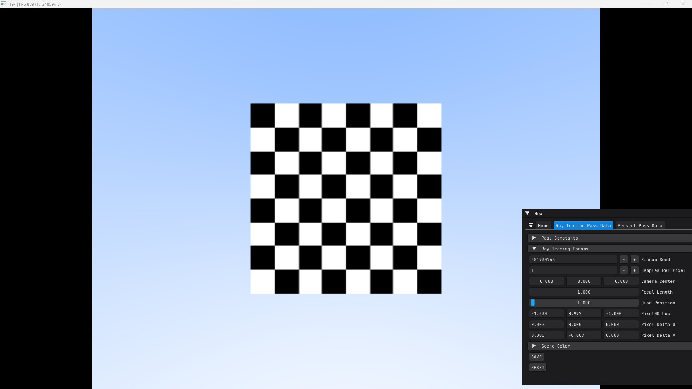
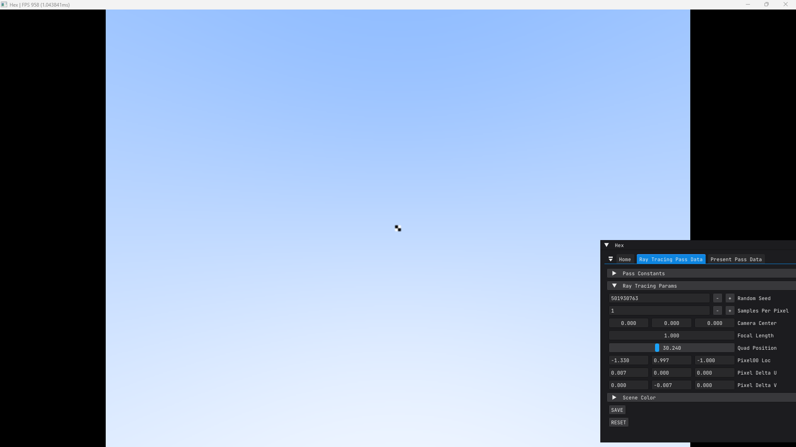
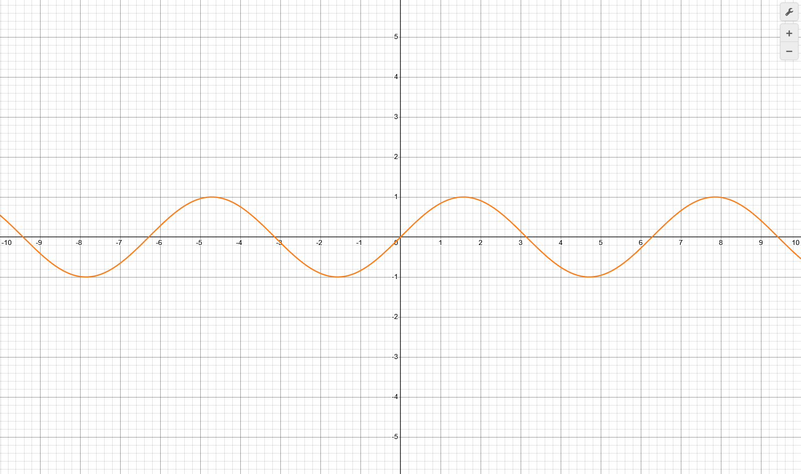

# Sampling

## Introduction
[Sampling parameters](https://docs.blender.org/manual/en/latest/render/cycles/render_settings/sampling.html) is the first thing that I setup after selecting my renderer as cycles. And the confusion that I have always had is that should I always go for the largest possible number that my computer can handle (which I used to do for the most part) or the lowest possible number that delivers reasonable image quality.  
For most of my projects, I ended up using default 4096 max samples for still images and reducing 512 to 1024 for animations to save some time; always leaving min samples to default (0).  
Everytime I read about render-time optimization, all the tutorials asked me to reduce the samples when needed and I (like most of the artists would naturally do) thought that if the default is 4096 and my computer is able to handle it, then why lower it unless absolutely necessary.

The world has effectively infinite resolution. But due to computation limits and display tech for which we aim to deliver our renders, we need to limit our resolution to a resonable size. Now take a look at this setup.  
We have a quad with an 8x8 checkerboard patter and basic ray quad intersection setup. And I have set it up such that we are casting one ray per pixel.  

If we are casing only a single ray per pixel, if we move the quad further back only a few rays hit it, then all rays might intersect only white tiles, or only black, or some odd combination, then in scenario like these we are loosing information and 2x2 quad.  

In the real world, we do not loose the number of quads when seeing from distance instead things grey out. To understand how we can achieve that in our simulation, we first need to understand what are digital images and pixels.

## Digital Images and Pixels

> A [digital image](https://www.esa.int/Education/8._Digital_image_processing) is a chorological matrix of pixel values. The size of the squares in the grid, the pixel, is equal to the spatial resolution of the (satellite) image and depend upon the instrument providing the data. Similarly the numbers in the grid are determined by the ability of the equipment to distinguish variations. Digital images often contain values between 0 and 255, which are matched exactly by the capacity of 1 byte in the computer.

You can think of light as a [continuous math function](https://en.wikipedia.org/wiki/Continuous_function). A function is said to be continuous when a slight change in its argument induces atleast a slight change in its resulting value. For example, sin(x) is a continuous function

Where a slight change in its argument `x` results in a change in its value. In other words if I ask you *what is the value of this function?*, instead of replying me with a definite answer, you will ask me ***for what x*** do I want the value. And for infinite values (1, 1.1, 1.01, 1.001, 1.0001 and so on) of `x` there will be different value for `y`

Similarly, the light rays are also continuous in nature. With each color of the [visible spectrum](https://en.wikipedia.org/wiki/Visible_spectrum) having a different frequency and wavelength. When capturing such signal, the system doesn't record continuous waves; it takes individual snapshot measurements at fixed intervals by process called sampling and quantization which we will explore later in the [camera properties chapter](#TODO), we get a digital image that is a rectilinear array of pixels.

> [A pixel is a point sample](https://www.researchgate.net/publication/244986797_A_Pixel_Is_Not_A_Little_Square_A_Pixel_Is_Not_A_Little_Square_A_Pixel_Is_Not_A_Little_Square). It exists only at a point. For a color picture, a pixel might actually contain three samples, one for each primary color contributing to the picture at the sampling point. We can still think of this as a point sample of a color.

When capturing a digital image (and audio as well), the system does not record continuous waves; it takes individual snapshot measurements at fixed intervals and to convert it back into an analog signal and show it via some display tech would need some way to reconstruct that captured image into a signal such that those infinite gaps are filled and are not noticeable to the human eye. A [reconstruction filter](https://en.wikipedia.org/wiki/Reconstruction_filter) is the formula or a low-pass filter that constructs a smooth analog signal from a digital input.

In context of images you can think of a filter as a [convolution operation](https://developer.nvidia.com/discover/convolution) over each of the pixel of our image. The idea is that while reconstructing the image back, instead of directly reading the pixel values, we take some weight of the neighbouring pixel values as well and then calculate the final color to be displayed. 

## What are samples?
The reason why we went through all these seemingly unrelated theory, is because this relates directly to where we shoot the camera rays and how we combine their radiance values into a final image. Because the values that the rays are going to give us are essentially the pixel values and instead of using just one value to reconstruct our image, we need multiple surrounding its neighbours.

> [Sampling](https://docs.blender.org/manual/en/latest/render/cycles/render_settings/sampling.html) is the process of tracing rays from the camera into the scene and bouncing them around until they reach a light source such as a Light object, an emissive mesh, or the world background. The algorithm for this is known as the integrator.
> - Viewport (Max) Samples
>   - **The number of paths to trace per pixel** in the 3D Viewport (when using the Rendered shading mode). Setting this value to zero enables indefinite sampling.
> - Render (Max) Samples
>   - **The number of paths to trace per pixel** in the final render. A higher number results in a cleaner image at the cost of a longer render time.
> - Time Limit
>   - Stops rendering if the time exceeds the limit, even if the desired sample count hasn’t been reached yet. Setting this value to zero disables the limit.

*The number of paths to trace per pixel* is now much more clear. The higher the number, the more rays will be casted and will be used to reconstruct our image.

## How does it work in practice?

